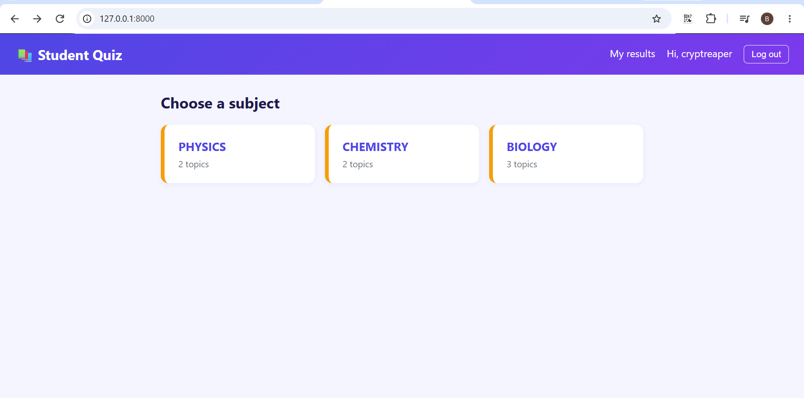
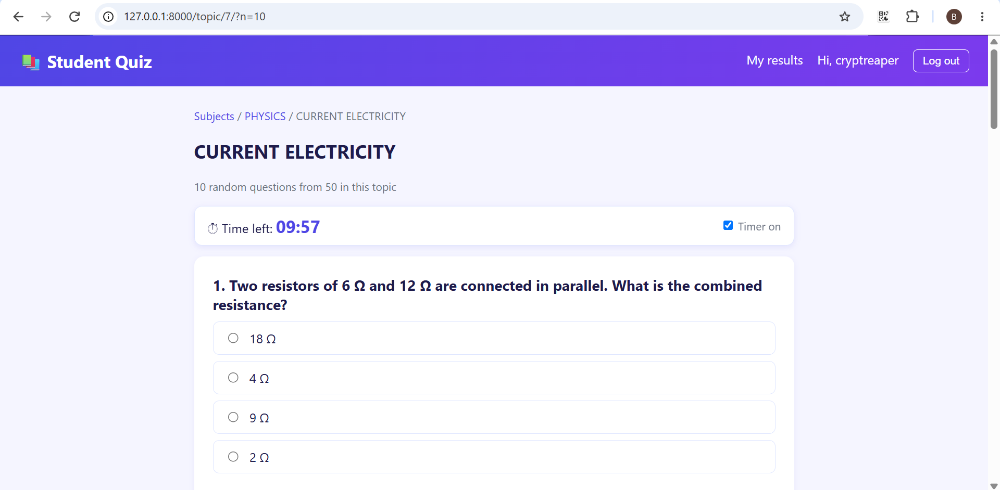

# Student Quiz

A Django web app where students practise science subjects with timed, multiple-choice quizzes in the style of the ACSEE exam. Students create an account, pick a subject and a topic, choose how many questions to answer, and get an instant score with a full review of every answer. Every result is saved, so students can track their progress over time.






## Features

- Student accounts: sign up, log in, and log out, with a welcome popup
- Quizzes and results are only available to logged-in students
- Subjects (Physics, Chemistry, Biology), each with several topics
- Choose a quiz of 10 questions, 20 questions, or all the questions in a topic
- Questions are picked at random and shown in a different order every time
- Countdown timer (1 minute per question) that submits the quiz automatically when time runs out, with an option to pause it for relaxed practice
- Instant score and percentage, with an encouraging message based on the result
- Review page showing your answer, the correct answer, and an explanation for every question
- Progress tracking: best score and number of attempts on each topic card
- "My results" page with the number of quizzes taken, average score, best score, and a full history with colour-coded badges
- Admin panel to add subjects, topics, and questions, and to view every student's attempts
- Bulk import of questions from CSV files with one command

## Question bank

The repository includes question files written in ACSEE style, each with explanations that show how the answer is reached:

| Subject | Topics |
|---|---|
| Physics | Projectile motion, Current electricity |
| Chemistry | Chemical kinetics, Atomic structure and the periodic table |
| Biology | Transport in plants, Reproduction, Genetics and inheritance |

More topics are added regularly.

## Built with

- Python
- Django
- HTML, CSS, and a little JavaScript (for the timer)

## How to run it

1. Clone the repository

```bash
   git clone https://github.com/Funnyboe13/quiz-website.git
   cd quiz-website
```

2. Create and activate a virtual environment

```bash
   python -m venv venv
   venv\Scripts\activate
```

3. Install the requirements

```bash
   pip install -r requirements.txt
```

4. Set up the database

```bash
   python manage.py migrate
   python manage.py createsuperuser
```

5. Load the questions (see the next section)

6. Start the server

```bash
   python manage.py runserver
```

7. Open http://127.0.0.1:8000, create a student account, and take a quiz

## Loading questions from CSV files

Every `.csv` file in the project folder holds the questions for one or more topics. Load a file with:

```bash
python manage.py import_questions reproduction_questions.csv
```

The command creates the subject and topic if they do not exist (capital letters are ignored when matching), skips questions that are already in the database, and reports any row with a problem. It is safe to run more than once.

Each file needs this header row, with one question per row:

```
subject,topic,question,option_a,option_b,option_c,option_d,correct,explanation
```

`correct` is the letter of the right answer (A, B, C, or D). Put any cell that contains a comma inside double quotes, and save the file as UTF-8.

You can also add or edit questions one at a time in the admin panel at http://127.0.0.1:8000/admin.

## Future improvements

- Optional fifth answer choice (A to E) to match the exam paper more closely
- Diagrams and circuit drawings attached to questions
- Leaderboard of top scores for each topic
- Live deployment

## Author

Made by Funnyboe13