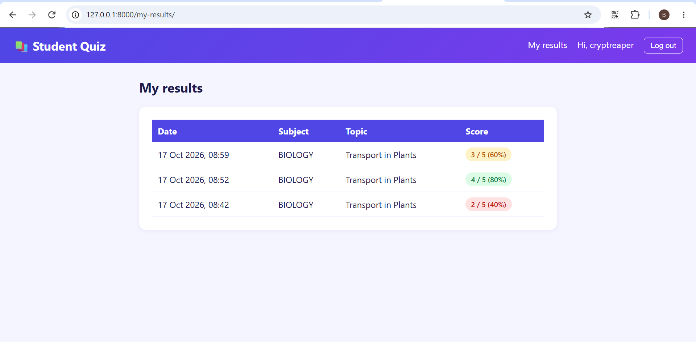
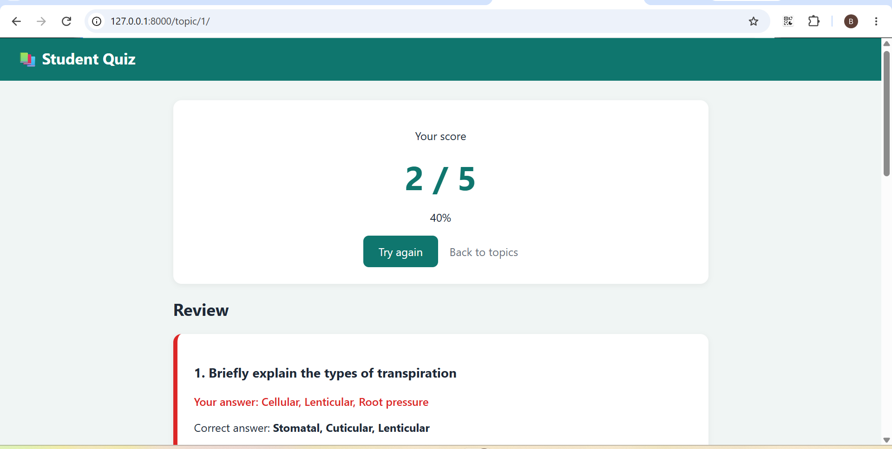

# Student Quiz

A Django web app where students practice science subjects with multiple-choice quizzes. Students create an account, pick a subject and topic, answer the questions, and get an instant score with a full review. Every result is saved, so students can track their progress over time.





## Features

- Student accounts: sign up, log in, and log out
- Welcome popup that appears after logging in or signing up
- Subjects (Physics, Chemistry, Biology), each with its own topics
- Multiple-choice questions with one correct answer
- Quizzes and results are only available to logged-in students
- Instant score and percentage after submitting
- Review page showing your answer, the correct answer, and an explanation
- Score history on a "My results" page, with colored badges for good, average, and low scores
- Admin panel to add subjects, topics, questions (all four choices on one page), and to view every student's attempts

## Built with

- Python
- Django
- HTML and CSS

## How to run it

1. Clone the repository

```bash
   git clone https://github.com/Funnyboe13/quiz-website.git
   cd quiz-website
```

2. Create and activate a virtual environment

```bash
   python -m venv venv
   venv\Scripts\activate
```

3. Install the requirements

```bash
   pip install -r requirements.txt
```

4. Set up the database

```bash
   python manage.py migrate
   python manage.py createsuperuser
```

5. Start the server

```bash
   python manage.py runserver
```

6. Open http://127.0.0.1:8000/admin, log in, and add subjects, topics, and questions. Then visit http://127.0.0.1:8000, create a student account, and take a quiz.

## Future improvements

- Random question order
- Timed quizzes
- Leaderboard for top scores
- Live deployment

## Author

Made by Funnyboe13